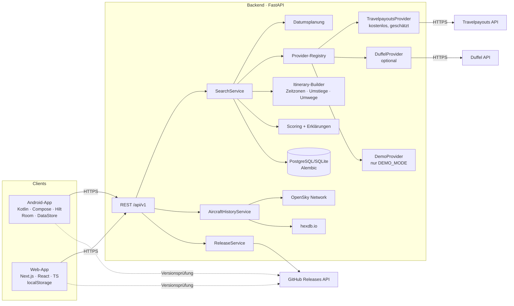

# Architektur

## Monorepo

| Pfad | Inhalt |
|---|---|
| `VERSION` | einzige Versionsquelle |
| `backend/` | FastAPI, Pydantic, SQLAlchemy, Alembic, Provider, Bewertung, Tests |
| `backend/app/data/` | kuratierte Referenzdaten (Flugzeugtypen, Flughäfen mit Zeitzonen, Airlines) – auch von Android/Web genutzt |
| `apps/web/` | Next.js (statischer Export), generierte API-Typen aus `shared/openapi.json` |
| `apps/android/` | Kotlin/Compose-App, Gradle Kotlin DSL, Version Catalog |
| `shared/` | OpenAPI-Spezifikation, Release-Konfiguration, gemeinsame Testvektoren, Release-Regeln |
| `scripts/` | README-Generator, Versions-Bump |
| `.github/workflows/` | CI, Release, Web-Deployment |

## Suchablauf

1. **Validierung** (Pydantic; dieselben Regeln clientseitig in Kotlin/TS).
2. **Routen**: Abflughäfen × Ziele; leeres Ziel = offene Suche über Drehkreuz-Kandidaten.
3. **Flexible Daten**: alle (Abflug, Rückflug)-Paare mit min ≤ Nächte ≤ max im Fenster; Auswahl gleichmäßig verteilt, die längstmögliche Reise ist immer dabei. Budget: `MAX_PROVIDER_CALLS_PER_SEARCH`.
4. **Provider-Abfragen**: Provider mit Zeitfenster-Suche (Travelpayouts) decken das ganze Fenster mit einer Abfrage je Monatspaar ab; sonst parallel (Semaphore), Timeouts, Retries mit Backoff (429/5xx/Netzwerk), Fehler je Abfrage → Status `partial`/`provider_error`.
5. **Itinerary-Builder**: UTC aus Ortszeit + IANA-Zeitzone (Datumsgrenze korrekt), Umstiegszeiten vs. geschätzte MCT, Flughafenwechsel, Übernachtungen, getrennte Tickets (+120 min Puffer), Umwegfaktor (Großkreis).
6. **Harte Filter**: Budget, ausgeschlossene Airlines, Umstiege, Reisezeit, Zeitfenster, ungültige Umstiege, Umweg > 2,5, Aufenthalt.
7. **Bewertung** (siehe unten) + **Erklärung** je Reise.
8. **Preiskalender**: günstigster erhaltener Preis je (Abflugdatum, Nächte) aus den gefilterten Angeboten.
9. **Persistenz** der Rohangebote; identische Suchen (Provider-relevante Felder) werden 15 min aus dem Cache bedient, gleichzeitige identische Suchen teilen sich eine Provider-Abfrage. Neue Gewichtungen → `/rescore` ohne neue Provider-Kosten.

## Bewertungsfunktion

Gesamtscore = Σ (Teilscore × Gewicht) / Σ Gewichte × 100. Teilscores ∈ [0, 1]:

| Komponente | Berechnung |
|---|---|
| Preis | günstigster Preis / Preis |
| Flugzeugerlebnis | (0,6 × bester Segmentwert + 0,4 × dauergewichteter Ø) / 10. Segmentwert = persönlicher Coolness-Score: Standard aus Katalog, eigene Bewertung ersetzt ihn; Wunschliste = max(Wert, 7) + 2; geflogen × `flown_factor`; uninteressant = 0; unbekannter Typ halbiert |
| Reisezeit | kürzeste Flugreisezeit / Flugreisezeit |
| Umstiege | 1 − (Umstiege je Richtung / 2) |
| Aufenthalt | volle Tage vor Ort / (max. Nächte − 1) |
| Airline | Anteil Segmente mit bevorzugten Airlines (0,5 ohne Präferenz) |
| Komfort | 1 − Abzüge: knapper Umstieg 0,3, langer 0,15, Übernachtung 0,25, Flughafenwechsel 0,3, getrennte Tickets 0,3, Umweg, Nachtabflug/-ankunft |

Modi: **Best Value** (5/4/3/3/3/1/2), **Aircraft Hunter** (2/9/2/1/2/1/1), **Cheapest Trip** (strikte Sortierung nach Preis nach Anwendung aller harten Filter). Eigene Gewichte überschreiben den Modus.

Erklärungen: stärkste Beiträge, Mehrpreis ggü. günstigster Option, **Wunschflugzeug-Aufpreis** ggü. der günstigsten Reise ohne Wunschflugzeug (pro Wunschtyp), schwache Komponenten, Unsicherheiten (Testdaten, geplante Flugzeugtypen, Angebotsablauf, Gepäck, Umstiegsrisiken) und eine **bessere Preis-Leistungs-Alternative**, falls eine günstigere Reise ≥ 10 % mehr Score pro Euro bei ≤ 8 Punkten Abstand bietet.

## Datenmodell

Backend (SQLAlchemy/Alembic): `airports`, `airlines` (inkl. ICAO-Codes), `aircraft_types`, `search_requests`, `search_results` (Itinerary inkl. Legs/Segments/Flights als JSON), `release_information`, `opensky_departure_days` und `aircraft_registry` (Caches für den Typverlauf). API-Schemas (Pydantic → OpenAPI): `Airport`, `Airline`, `AircraftType`, `Segment` (Flight), `Leg`, `Connection`, `Itinerary`, `SearchRequest`, `SearchResponse`, `ScoredItinerary`, `UserPreferences`, `Weights`, `ReleaseInfo`.

Lokal (keine Konten nötig): Android Room `favorite_trips`, `favorite_aircraft`, `flight_log` + DataStore (Einstellungen); Web `localStorage` (`ato.settings.v1`, `ato.favorites.v1`, `ato.logbook.v1`).

## Erweiterbarkeit

- `Itinerary.legs` ist eine Liste mit `direction` → Open-Jaw, Gabelflüge und Rundreisen (`onward`) ohne Schemabruch.
- `Ticketing.separate_tickets` ist im Builder/Scoring berücksichtigt (größere Puffer, Risiko-Abzug), sobald ein Provider getrennte Tickets kombiniert.
- Weitere Provider über `FlightProvider` (siehe `docs/PROVIDERS.md`).
